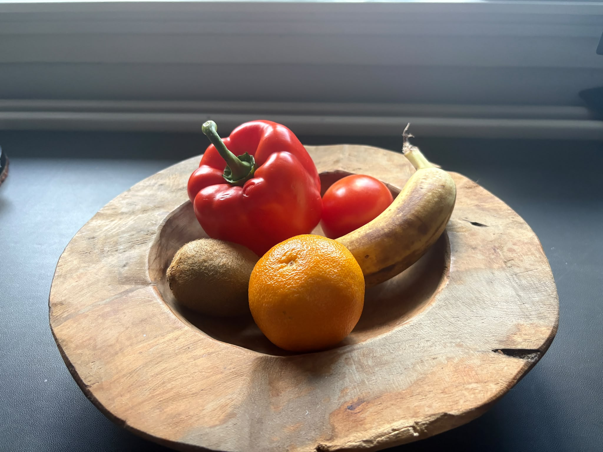
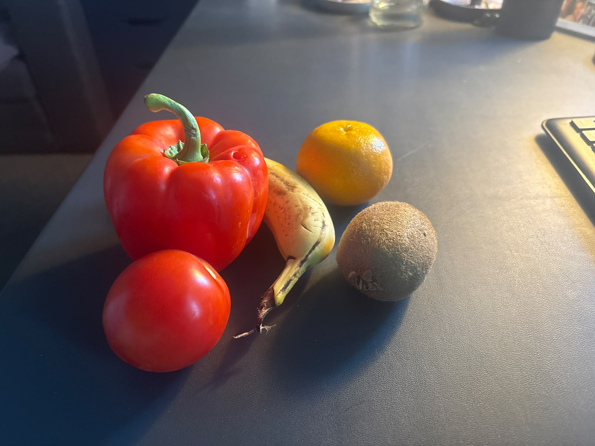
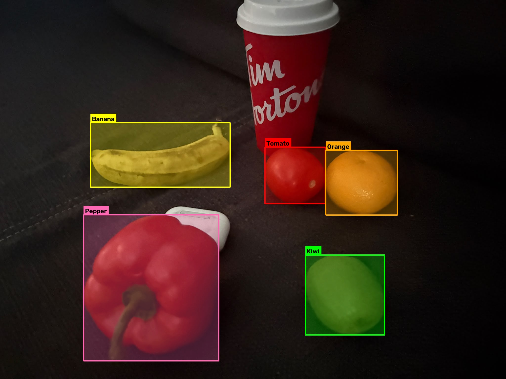

# yolo-finetune-vision

This repository showcases the full end-to-end pipeline to fine-tune a **YOLOv8** object detection model on a custom dataset inside a containerized development environment.


*(Note: Replace `assets/bbox_placeholder.png` with an actual inference image showcasing detected bounding boxes.)*

---

## 📋 Prerequisites

Before getting started, ensure your system meets the following requirements to support GUI/X11 forwarding and GPU-accelerated Docker containers:

* **WSL2** (Windows Subsystem for Linux 2) installed and configured.
* **Docker Desktop** installed with WSL2 integration enabled.
* **X11 Server** running on your host machine (e.g., VcXsrv, X410, or WSLg) to allow GUI display output from the Docker container.
* **Visual Studio Code** with the [Dev Containers](https://marketplace.visualstudio.com/items?itemName=ms-vscode-remote.remote-containers) extension installed.

---

## Environment Setup

This project uses a VS Code Dev Container to automatically configure all dependencies, CUDA drivers, and Ultralytics packages.

1. Clone the repository and open the folder in **VS Code**:
   ```bash
   git clone https://github.com/your-username/yolo-finetune-vision.git
   cd yolo-finetune-vision
   code .
   ```

2. Open the VS Code Command Palette (`Ctrl + Shift + P` or `Cmd + Shift + P`).
3. Run the following command to build the environment:
   ```text
   Dev Containers: Rebuild and Reopen in Container
   ```
   > **Note:** The initial build will take several minutes as it pulls the base image and installs all required computer vision dependencies. Once complete, you will have a fully isolated and ready-to-use environment.

---

## Dataset Preparation

To fine-tune the YOLOv8 model, you need a labeled image dataset formatted specifically for YOLO.

### Sample Dataset Scenes

| Type | Scene 1 | Scene 2 | Scene 3 | Scene 4 |
| :--- | :---: | :---: | :---: | :---: |
| **Original Image** |  |  |  |  |
| **Labelled Image** |  |  |  |  |

### 1. Labeling Your Images
Annotate your custom images with bounding boxes. You can do this manually using local tools (e.g., LabelImg, CVAT) or via cloud platforms like [Roboflow](https://roboflow.com/). Export your annotations in **YOLOv8 format** (`.txt` files containing `<class_id> <x_center> <y_center> <width> <height>`).

### 2. Directory Structure & Splitting
To ensure an unbiased and fair evaluation of your model's performance, we split the dataset into `train`, `val`, and `test` sets (e.g., a 70% / 20% / 10% split). 

Place your organized dataset inside the `/data` directory following this structure:

```text
data/
├── data.yaml
├── train/
│   ├── images/
│   └── labels/
```

After this we split it into train / val / test


---

## Training 


## Evaluation & Analysis