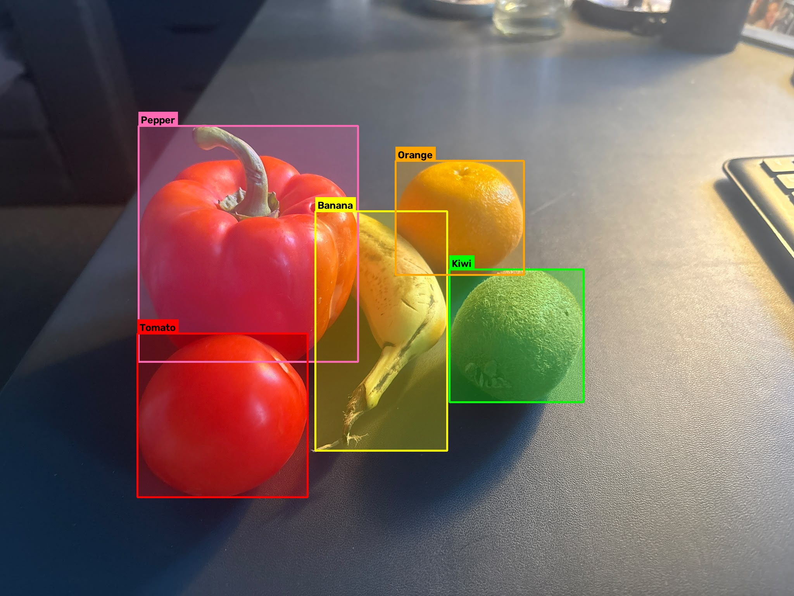
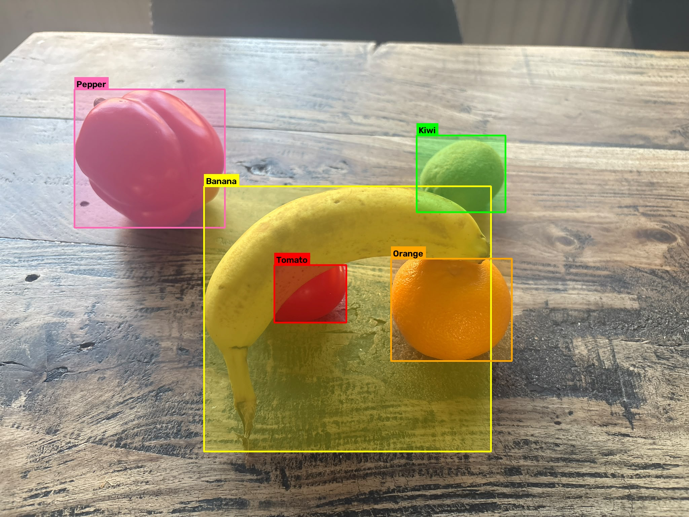

# Fruit-Vision

This repository showcases the full end-to-end pipeline to fine-tune a **YOLOv8** object detection model on a custom dataset inside a containerized development environment.


---

## 0. Prerequisites

Before getting started, ensure your system meets the following requirements to support GUI/X11 forwarding and GPU-accelerated Docker containers:

* **WSL2** (Windows Subsystem for Linux 2) installed and configured.
* **Docker Desktop** installed with WSL2 integration enabled.
* **X11 Server** running on your host machine (e.g., VcXsrv, X410, or WSLg) to allow GUI display output from the Docker container.
* **Visual Studio Code** with the [Dev Containers](https://marketplace.visualstudio.com/items?itemName=ms-vscode-remote.remote-containers) extension installed.

---

## 1. Environment Setup

This project uses a VS Code Dev Container to automatically configure all dependencies, CUDA drivers, and Ultralytics packages.

1. Clone the repository and open the folder in **VS Code**:
   ```bash
   git clone https://github.com/your-username/yolo-finetune-vision.git
   cd yolo-finetune-vision
   ```

2. Open the VS Code Command Palette (`Ctrl + Shift + P` or `Cmd + Shift + P`).
3. Run the following command to build the environment:
   ```text
   Dev Containers: Rebuild and Reopen in Container
   ```
   > **Note:** The initial build will take several minutes as it pulls the base image and installs all required computer vision dependencies. Once complete, you will have a fully isolated and ready-to-use environment.

---

## 2. Dataset Preparation

To fine-tune the YOLOv8 model, you need a labeled image dataset formatted specifically for YOLO.

### Sample Dataset Scenes

| Type | Scene 1 | Scene 2 | Scene 3 | Scene 4 |
| :--- | :---: | :---: | :---: | :---: |
| **Original Image** |  |  |  |  |
| **Labelled Image** |  |  |  |  |

### 2.1 Labeling Your Images
Annotate your custom images with bounding boxes. You can do this manually using local tools (e.g., LabelImg, CVAT) or via cloud platforms like [Roboflow](https://roboflow.com/). Export your annotations in **YOLOv8 format** (`.txt` files containing `<class_id> <x_center> <y_center> <width> <height>`, with dimensions normalized by image width and height from 0-1).

### 2.2 Directory Structure & Dataset Splitting

To ensure a fair and unbiased evaluation of the model, the dataset is divided into three subsets: **training**, **validation**, and **testing**.

Rather than performing a purely random split, this project uses a **scene-based split** to evaluate how well the model generalizes to different environments and lighting conditions.

First, place your original dataset inside the `/data` directory, following this structure:

```text
data/
├── data.yaml
└── train/
    ├── images/
    └── labels/
```

The `images/` directory should contain the original images, while `labels/` should contain their corresponding YOLO-format annotation files.

Once the dataset is organized, run the splitting script from the project root:

```bash
python utils/generate_split.py \
    --images_path /app/data/train/images \
    --labels_path /app/data/train/labels \
    --target_dir /app/data
```

**Scene-based splitting strategy**

For this project, images are grouped according to their original scene:

- **Training:** Scenes 1 and 3, used to train the model.
- **Validation:** Scene 2, used to monitor model performance and guide training.
- **Testing:** Scene 4, reserved for evaluating generalization under different lighting conditions (dark-room environment).

This approach helps assess whether the model can generalize to previously unseen scenes rather than simply memorizing the conditions present in the training data.

After running the script, the dataset should follow this structure:

```text
data/
├── data.yaml
├── images/
│   ├── train/
│   ├── val/
│   └── test/
└── labels/
    ├── train/
    ├── val/
    └── test/
```

Finally, make sure that the paths specified in `data.yaml` match the generated directory structure and that the class IDs and class names are correctly mapped.

> **Note:** Keep the test set separate from the training and validation processes. It should only be used for the final evaluation to provide an unbiased estimate of the model's generalization performance.
---

## 3. Training 


## 4. Evaluation & Analysis

