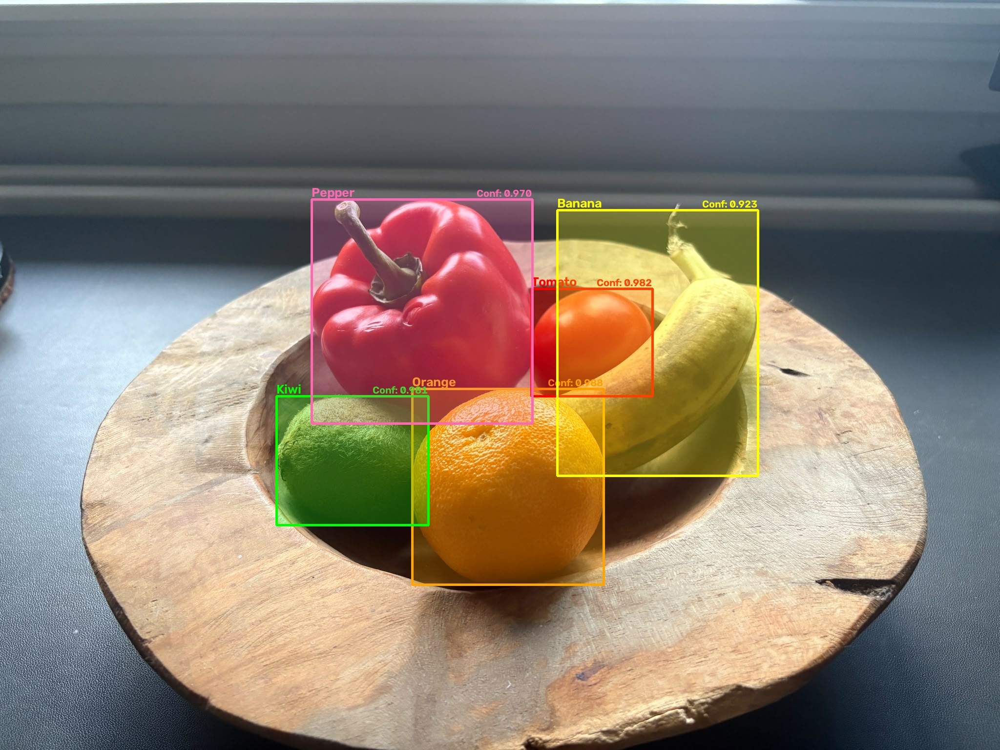
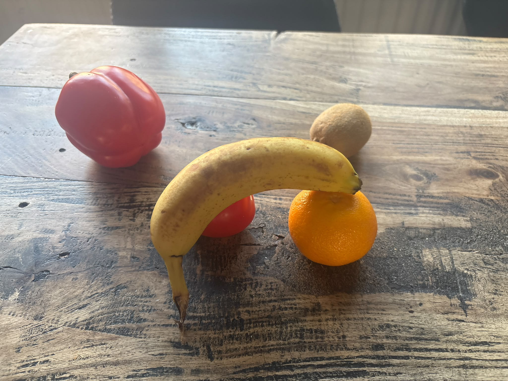
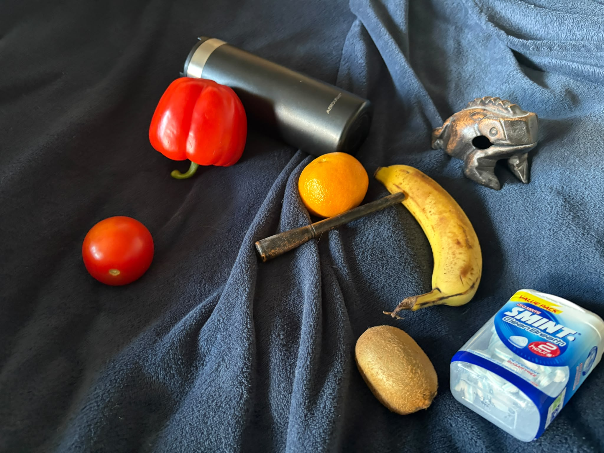
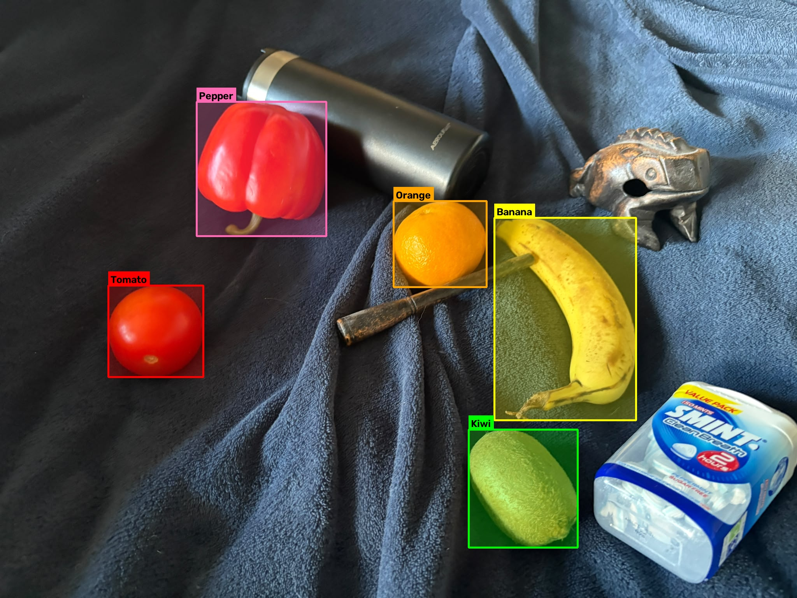
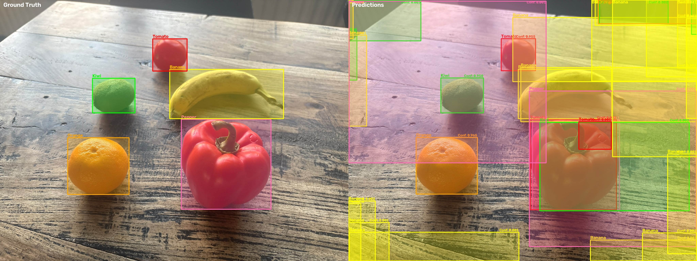

# Fruit-Vision

This repository showcases the full end-to-end pipeline to fine-tune a **YOLOv8** object detection model on a custom dataset inside a containerized development environment.



---

## 0. Prerequisites

Before getting started, ensure your system meets the following requirements to support GUI/X11 forwarding and GPU-accelerated Docker containers:

* **WSL2** (Windows Subsystem for Linux 2) installed and configured.
* **Docker Desktop** installed with WSL2 integration enabled.
* **X11 Server** running on your host machine (e.g., VcXsrv, X410, or WSLg) to allow GUI display output from the Docker container.
* **Visual Studio Code** with the [Dev Containers](https://marketplace.visualstudio.com/items?itemName=ms-vscode-remote.remote-containers) extension installed.

---

## 1. Environment Setup

This project uses a VS Code Dev Container to automatically configure all dependencies, CUDA drivers, and Ultralytics packages.

1. Clone the repository and open the folder in **VS Code**:
   ```bash
   git clone https://github.com/rick-degraaf/fruit-vision.git
   cd fruit-vision
   ```

2. Open the VS Code Command Palette (`Ctrl + Shift + P` or `Cmd + Shift + P`).
3. Run the following command to build the environment:
   ```text
   Dev Containers: Rebuild and Reopen in Container
   ```
   > **Note:** The initial build will take several minutes as it pulls the base image and installs all required computer vision dependencies. Once complete, you will have a fully isolated and ready-to-use environment.

---

## 2. Dataset Preparation

To fine-tune the YOLOv8 model, you need a labeled image dataset formatted specifically for YOLO.

### Sample Dataset Scenes

| Type | Scene 1 | Scene 2 | Scene 3 | Scene 4 |
| :--- | :---: | :---: | :---: | :---: |
| **Original Image** |  |  |  |  |
| **Labelled Image** |  |  |  |  |

### 2.1 Labeling Your Images
Annotate your custom images with bounding boxes. You can do this manually using local tools (e.g., LabelImg, CVAT) or via cloud platforms like [Roboflow](https://roboflow.com/). Export your annotations in **YOLOv8 format** (`.txt` files containing `<class_id> <x_center> <y_center> <width> <height>`, with dimensions normalized by image width and height from 0-1).

### 2.2 Directory Structure & Dataset Splitting

To ensure a fair and unbiased evaluation of the model, the dataset is divided into three subsets: **training**, **validation**, and **testing**.

Rather than performing a purely random split, this project uses a **scene-based split** to evaluate how well the model generalizes to different environments and lighting conditions.

First, place your original dataset inside the `/data` directory, following this structure:

```text
data/
├── data.yaml
└── train/
    ├── images/
    └── labels/
```

The `images/` directory should contain the original images, while `labels/` should contain their corresponding YOLO-format annotation files.

Once the dataset is organized, run the splitting script from the project root:

```bash
python utils/generate_split.py \
    --images_path /app/data/train/images \
    --labels_path /app/data/train/labels \
    --target_dir /app/data
```

**Scene-based splitting strategy**

For this project, images are grouped according to their original scene:

- **Training:** Scenes 1 and 3, used to train the model.
- **Validation:** Scene 2, used to monitor model performance and guide training.
- **Testing:** Scene 4, reserved for evaluating generalization under different lighting conditions (dark-room environment).

This approach helps assess whether the model can generalize to previously unseen scenes rather than simply memorizing the conditions present in the training data.

After running the script, the dataset should follow this structure:

```text
data/
├── data.yaml
├── images/
│   ├── train/
│   ├── val/
│   └── test/
└── labels/
    ├── train/
    ├── val/
    └── test/
```

Finally, make sure that the paths specified in `data.yaml` match the generated directory structure and that the class IDs and class names are correctly mapped.

> **Note:** Keep the test set separate from the training and validation processes. It should only be used for the final evaluation to provide an unbiased estimate of the model's generalization performance.
---

## 3. Model Training

With the dataset prepared and split into training, validation, and testing subsets, we can proceed with fine-tuning the YOLOv8 model.

This project uses **YOLOv8n**, a lightweight object detection model pretrained on the COCO 2017 dataset. By fine-tuning its pretrained weights on our custom five-class fruit dataset, we adapt the model to recognize and detect the specific fruit categories of interest.

### 3.1 Running the Training Script

Navigate to the `/app/train` directory inside the development container and execute the training script:

```bash
python train.py
```

The training script supports several command-line arguments to customize the training configuration. Each argument has a default value, allowing you to start training without specifying additional parameters.

| Argument | Default | Description |
| :--- | :--- | :--- |
| `--weights` | `/app/weights/yolov8n.pt` | Path to the pretrained YOLOv8 model weights. |
| `--data` | `/app/data/data.yaml` | Path to the dataset configuration file. |
| `--imgsz` | `640` | Input image size used during training. |
| `--batch` | `8` | Number of images processed per training batch. |
| `--workers` | `2` | Number of dataloader worker processes. |
| `--epochs` | `40` | Number of complete passes through the training dataset. |
| `--seed` | `0` | Random seed to improve reproducibility. |
| `--project` | `/app/runs` | Directory where training results are stored. |
| `--name` | `baseline_yolov8n` | Name of the training run. |

### 3.2 Customizing Training Parameters

All training parameters can be overridden directly through command-line arguments. For example, to train for 100 epochs with a batch size of 16:

```bash
python train.py \
    --weights /app/weights/yolov8n.pt \
    --data /app/data/data.yaml \
    --imgsz 640 \
    --batch 16 \
    --workers 4 \
    --epochs 100 \
    --seed 42 \
    --project /app/runs \
    --name experiment_01
```

### 3.3 Training Outputs

Once training starts, Ultralytics automatically creates an output directory under `runs/`, containing the results of the training process.

For the default configuration, the output directory is:

```text
runs/
└── baseline_yolov8n/
    ├── weights/
    │   ├── best.pt
    │   └── last.pt
    ├── results.csv
    ├── results.png
    ├── confusion_matrix.png
    └── ...
```

The two most important output files are:

- **`best.pt`**: Model weights from the epoch with the best validation performance.
- **`last.pt`**: Model weights from the final training epoch.

The training metrics and visualizations can be used to analyze model convergence, identify potential overfitting, and assess detection performance.

The resulting `best.pt` checkpoint will be used for the subsequent evaluation and inference stages.

## 4. Evaluation & Analysis

After training, we evaluate the model to assess its detection performance, analyze its predictions, and identify potential areas for improvement.

Throughout development, we use the **validation set (Scene 2)** for model evaluation and analysis. The **test set (Scene 4)** remains completely separate and is reserved for the final evaluation once the model configuration and detection thresholds have been finalized.

Ultralytics provides built-in validation functionality to calculate standard object detection metrics, such as precision, recall, and mean Average Precision (mAP). However, to better understand the underlying evaluation process, this project also implements the prediction visualization and metric calculations manually in the following sections.

### 4.1 Running Inference on the Validation Set

Before comparing ground-truth annotations with model predictions, we first need to run inference on the validation images.

Navigate to the `/app/train` directory inside the development container and execute:

```bash
python inference.py --save_txt --save_conf
```

The inference script supports the following command-line arguments:

| Argument | Default | Description |
| :--- | :--- | :--- |
| `--weights` | `/app/runs/baseline_yolov8n/weights/best.pt` | Path to the trained model weights. |
| `--data` | `/app/data/images/val` | Directory containing the validation images. |
| `--conf` | `0.001` | Minimum confidence threshold for retaining predictions. |
| `--save_txt` | `False` | Whether to save predictions in YOLO-format `.txt` files. |
| `--save_conf` | `False` | Whether to include confidence scores in the saved prediction files. |
| `--project` | `/app/runs` | Directory where inference results are stored. |
| `--name` | `val_preds` | Name of the inference run. |

For this project, the default configuration is sufficient. In particular, the confidence threshold is set to **0.001** to retain a large number of candidate detections.

This deliberately low threshold allows us to inspect the model's raw predictions and calculate evaluation metrics across different confidence thresholds in subsequent sections, rather than filtering out potentially relevant detections too early.

### 4.2 Prediction Outputs

After inference is complete, Ultralytics creates an output directory containing the predictions for the validation images.

With the default configuration, the results are stored in:

```text
/app/runs/val_preds/
```

The directory contains a `.txt` file for each validation image, storing the predicted bounding boxes in YOLO format.

Each prediction contains the following information:

```text
<class_id> <x_center> <y_center> <width> <height> <confidence>
```

The bounding box coordinates are normalized relative to the image dimensions. Confidence scores are included when the `--save_conf` argument is enabled.

### 4.3 Visualizing Ground Truth vs. Predictions

To inspect the model's predictions, we can visualize the ground-truth bounding boxes alongside the predicted bounding boxes.

This can be done using the visualization script:

```bash
python /app/utils/visualize_bbox_GT_vs_Pred.py
```

The script compares the original annotations with the predictions generated during the previous inference step.

**Ground Truth vs. Model Predictions**



The visualization shows the ground-truth bounding boxes on the left and the model's predicted bounding boxes on the right.

As can be observed, the predicted bounding boxes may initially appear cluttered, with multiple overlapping detections and false positives.

This is expected because inference was performed using a very low confidence threshold (`0.001`). Consequently, many low-confidence candidate detections are retained instead of being filtered out.

In the following sections, we will use these predictions to implement and analyze the evaluation metrics manually, including confidence-based filtering and the matching of predicted bounding boxes against ground-truth annotations.

This provides a better understanding of how object detection performance is measured and how metrics such as precision, recall, and mAP are obtained.