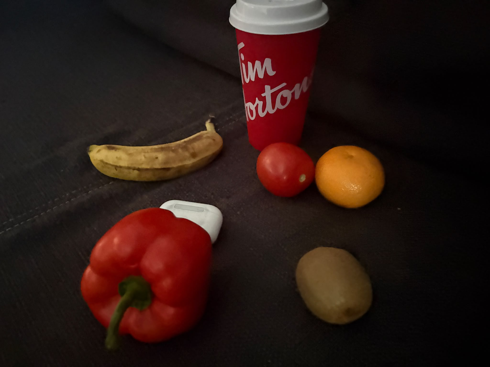

# Fruit-Vision

This repository showcases the full end-to-end pipeline to fine-tune a **YOLOv8** object-detection model on a custom five-class fruit dataset inside a containerized development environment.


**Technologies:** Python · Ultralytics YOLOv8 · PyTorch · NumPy · Docker · Roboflow · Visual Studio Code

**Focus:** Object Detection & Evaluation

---

## Project Pipeline & Documentation

The project covers the complete object-detection workflow, from setting up the development environment to evaluating the trained model.

| Stage | Description | Documentation |
|---|---|---|
| **Installation** | Set up the development environment using WSL2, Docker and VS Code Dev Containers. | [Installation](docs/installation.md) |
| **Dataset Labelling & Preparation** | Annotate images in YOLO format, organize the dataset and perform a scene-based split. | [Dataset Preparation](docs/dataset-preparation.md) |
| **Model Training & Inference** | Fine-tune the pretrained YOLOv8n model and generate predictions on the validation set. | [Model Training](docs/training.md) · [Inference](docs/inference.md) |
| **Model Evaluation** | Compare predictions against ground-truth annotations and calculate object-detection metrics. | [Model Evaluation](docs/evaluation.md) |

## 0. Getting Started

Clone the repository and open it in Visual Studio Code:

```bash
git clone https://github.com/rick-degraaf/fruit-vision.git
cd fruit-vision
```

Open the VS Code Command Palette (`Ctrl + Shift + P`) and run:

```text
Dev Containers: Rebuild and Reopen in Container
```

The development container automatically configures the required dependencies and development environment.

For the prerequisites and full installation instructions, see the [Installation Guide](docs/installation.md).

## 1. Dataset Labelling & Preparation

The first step is to annotate the fruit images with bounding boxes and export the annotations in YOLO format.

For this project, five fruit classes are used. The annotations contain the class ID and normalized bounding-box coordinates.

### Sample Dataset Scenes

| Type | Scene 1 | Scene 2 | Scene 3 | Scene 4 |
|---|:---:|:---:|:---:|:---:|
| **Original Image** |  |  |  |  |
| **Labelled Image** |  |  |  |  |

The annotated dataset is split into training, validation and test subsets. Rather than using a random split, this project uses a scene-based approach:

- **Training:** Scenes 1 and 3.
- **Validation:** Scene 2.
- **Testing:** Scene 4.

This allows the model to be evaluated on a previously unseen scene with different lighting conditions.

For more information about the annotation format, dataset structure and splitting process, see [Dataset Preparation](docs/dataset-preparation.md).

## 2. Model Training & Inference

The model used in this project is **YOLOv8n**, initialized with pretrained weights and fine-tuned on the custom five-class fruit dataset.

### Training

To start training inside the development container, navigate to the `/app/train` directory and run:

```bash
cd /app/train
python train.py
```

The trained model weights and training results are saved under:

```text
runs/
└── baseline_yolov8n/
    ├── weights/
    │   ├── best.pt
    │   └── last.pt
    ├── results.csv
    ├── results.png
    └── ...
```

The `best.pt` checkpoint is used for the subsequent inference stage.

For the training configuration and available command-line arguments, see [Model Training](docs/training.md).

### Inference

After training, inference is performed on the validation images using the best model checkpoint.

To generate predictions and save them in YOLO format with confidence scores, run:

```bash
cd /app/train
python inference.py --save_txt --save_conf
```

A low confidence threshold (`0.001`) is used to retain a large number of candidate detections. This allows the predictions to be evaluated at different confidence thresholds during the subsequent evaluation.

The generated prediction files are saved under `/app/runs/val_preds/`.

For more information about inference settings and prediction outputs, see [Inference](docs/inference.md).

## 3. Model Evaluation

The model is evaluated by comparing its predictions against the ground-truth annotations on the validation set (Scene 2). The test set (Scene 4) remains separate and is reserved for the final evaluation.

The custom evaluation implementation calculates precision, recall, F1 score, Average Precision (AP) and mean Average Precision (mAP).

### Evaluation Results

The custom evaluation implementation produced the following validation results:

| Metric | Result |
|---|---:|
| mAP@0.5 | 0.9635 |
| mAP@0.5:0.95 | ~0.8800 |

### Ground Truth vs. Predictions


The visualization compares the ground-truth bounding boxes with the model's predicted bounding boxes. Although the model detects the majority of the objects, some overlapping detections and false positives remain.

### Precision-Recall Curve

| Precision-Recall Curve | Localization Performance |
|:---:|:---:|
|  |  |

The PR curve for class 0 (Banana) shows the relationship between precision and recall at different confidence thresholds.

At a confidence threshold of `0.25` and an IoU threshold of `0.5`, the model achieves:

- **Precision:** 0.9194
- **Recall:** 0.9344
- **F1 score:** 0.9268

### Localization Performance

The PR curves show how detection performance changes as the IoU threshold increases. The decrease in AP at stricter thresholds indicates that the predicted bounding boxes are less consistently aligned with the ground-truth annotations when a higher overlap is required.

For the full evaluation procedure, metric calculations and detailed results, see [Model Evaluation](docs/evaluation.md).
