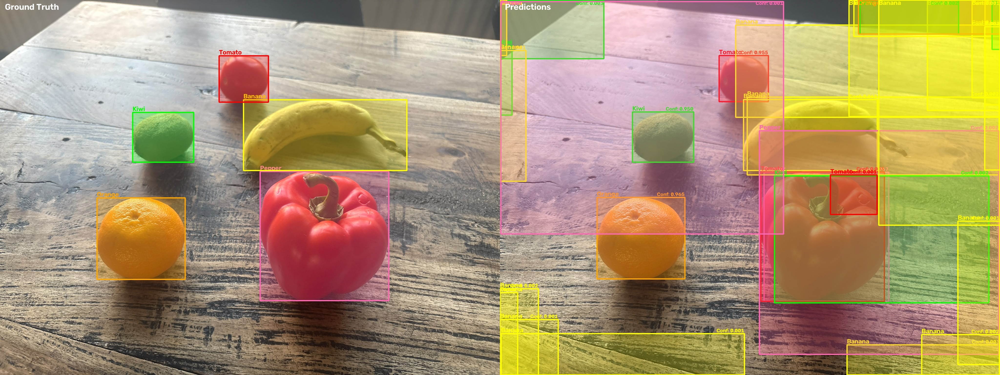
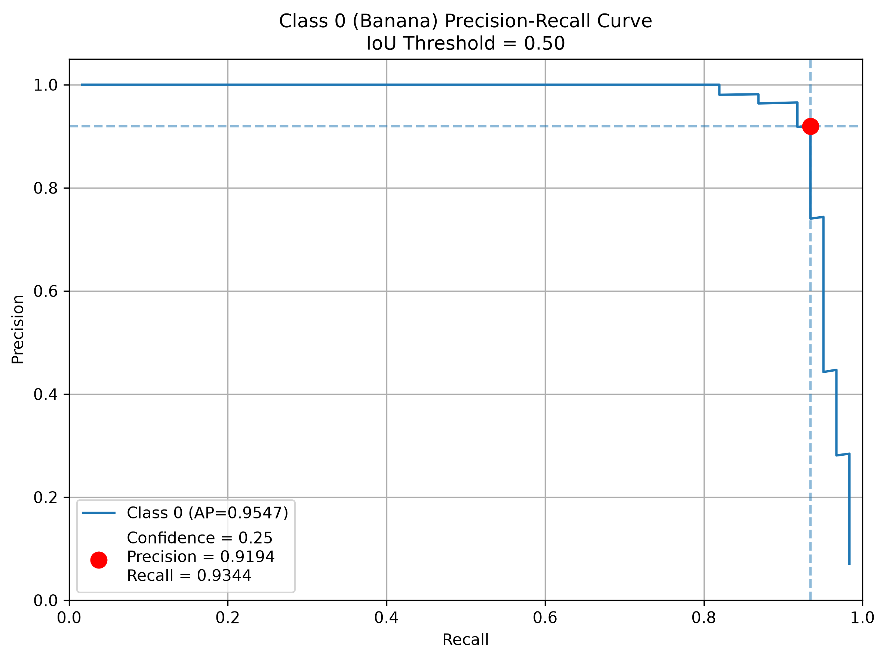
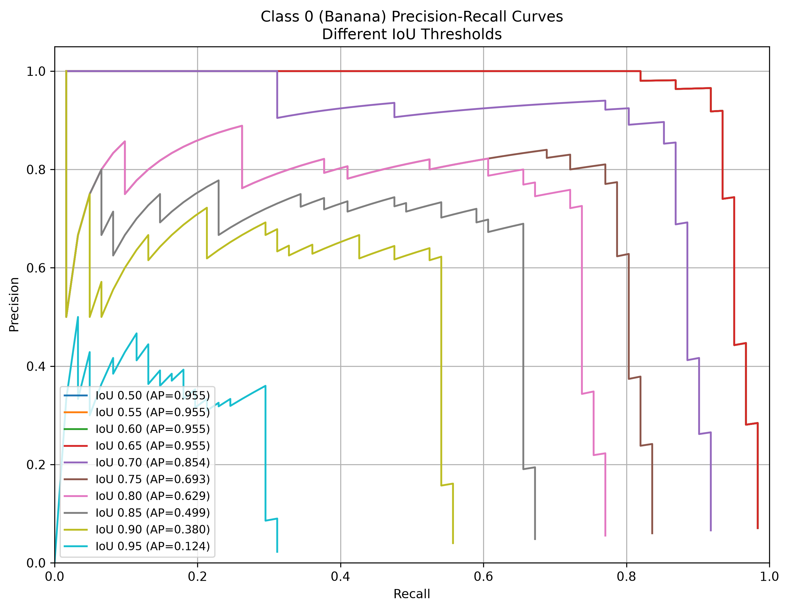

# Model Evaluation

The model is evaluated by comparing its predicted bounding boxes against the ground-truth annotations.

This project includes a custom evaluation implementation to calculate detection metrics and generate Precision-Recall curves.

## Evaluation Dataset

The validation set consists of Scene 2. Scene 4 is reserved for the final test evaluation and is kept separate from the training and validation process.

The evaluation process uses the prediction files generated during inference and the corresponding ground-truth annotation files.

## Evaluation Metrics

The implementation calculates the following metrics:

- **Precision:** The proportion of predicted detections that are correct.
- **Recall:** The proportion of ground-truth objects that are successfully detected.
- **F1-score:** The harmonic mean of precision and recall.
- **Average Precision (AP):** The area under the Precision-Recall curve for an individual class.
- **Mean Average Precision (mAP):** The mean AP across all classes.

The evaluation includes both mAP@0.5 and mAP@0.5:0.95.

For mAP@0.5:0.95, AP is calculated at ten IoU thresholds, ranging from 0.50 to 0.95 in increments of 0.05. The resulting AP values are averaged across the thresholds and classes.

## Matching Predictions to Ground Truth

Predictions are sorted by confidence score for each class.

Each prediction is compared against ground-truth boxes of the same class in the same image. A prediction is considered a true positive when it matches an unmatched ground-truth box with an IoU equal to or greater than the selected threshold.

Each ground-truth box can only be matched once. Additional detections for an already matched object are counted as false positives.

This matching process is repeated to calculate the cumulative true positives and false positives used to generate the Precision-Recall curves.

## Overall Results

The following results were obtained on the validation set:

| Metric | Result |
|---|---:|
| mAP@0.5 | 0.9635 |
| mAP@0.5:0.95 | ~0.8800 |

These values are based on the custom evaluation implementation included in this repository.

## Class-Level Results

The following example shows the results for class 0 (Banana), using an IoU threshold of 0.5 and a confidence threshold of 0.25.

| Metric | Result |
|---|---:|
| True Positives | 57 |
| False Positives | 5 |
| False Negatives | 4 |
| Ground Truth Objects | 61 |
| Predictions | 62 |
| Precision | 0.9194 |
| Recall | 0.9344 |
| F1-score | 0.9268 |
| AP@0.5 | 0.9547 |

## Visual Results

### Ground Truth vs. Predictions

This comparison provides a visual overview of the predicted bounding boxes alongside the ground-truth annotations. It helps identify missed detections, false positives, and differences in bounding-box placement.

### Precision-Recall Curve

The Precision-Recall curve illustrates the relationship between precision and recall at different confidence thresholds.

### Precision-Recall Curves at Different IoU Thresholds

Comparing the curves at different IoU thresholds provides additional insight into localization performance. A stricter IoU threshold requires the predicted bounding boxes to align more closely with the ground-truth boxes.

The decline in performance at higher IoU thresholds suggests that localization accuracy has room for improvement. Annotation consistency and dataset size can also influence these results.

## Conclusion

The validation results show that the model achieves strong detection performance on the custom fruit dataset. However, the results also show that there is room to improve bounding-box localization, particularly at stricter IoU thresholds.

Scene 4 remains reserved for final testing, providing a separate scene and lighting environment to assess how well the trained model generalizes to unseen images.