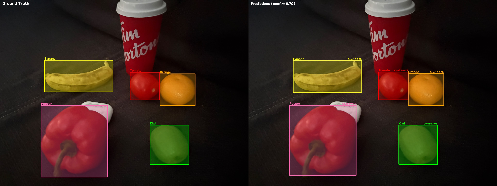

# Model Testing

## Overview

After training and validation, the model is evaluated on a separate test set consisting of Scene 4. These images are held out from both training and validation and contain different lighting conditions.

The purpose of testing is to assess how well the trained YOLOv8n model generalizes to an unseen scene.

## Test Dataset

The test set contains 65 images from Scene 4. It is kept separate from the training and validation data to provide an independent evaluation of the model.

## Running the Evaluation

Run the custom evaluation script:

```bash
python eval/evaluation.py
```

The script compares the model's predictions against the ground-truth annotations and calculates mean Average Precision (mAP) across multiple IoU thresholds.

## Test Results

The evaluation produced the following results:

| Metric | Result |
|---|---:|
| mAP@0.5 | 0.8202 |
| mAP@0.5:0.95 | 0.7701 |

The mAP@0.5:0.95 metric averages the AP values calculated at IoU thresholds from 0.50 to 0.95, in increments of 0.05.

## Ground Truth vs. Predictions

The following visualization compares the ground-truth bounding boxes with the model's predictions on an image from the test scene.



## Validation vs. Test Performance

Comparing validation and test results provides an indication of how well the model generalizes to unseen data.

| Metric | Validation (Scene 2) | Test (Scene 4) | Difference |
|---|---:|---:|---:|
| mAP@0.5 | 0.9635 | 0.8202 | -0.1433 |
| mAP@0.5:0.95 | ~0.8800 | 0.7701 | ~-0.1099 |

The model achieves lower mAP on the test set than on the validation set. The different lighting conditions in Scene 4 may contribute to this decrease in performance.

Despite this drop, the model achieves an mAP@0.5 of 0.8202 on the unseen test scene, indicating that it retains the ability to detect fruit under conditions not encountered during training or validation.

This comparison highlights the importance of evaluating object-detection models on a separate test set, rather than relying solely on validation results.